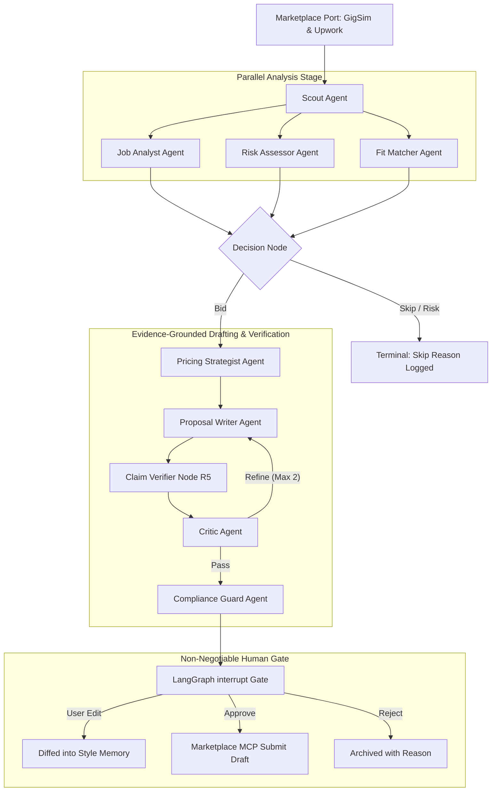

# GigBid — Multi-Agent Freelancer Copilot

> **AI-4016 R&D Assignment** · FAST School of Computing, FAST-NUCES Islamabad  
> **Instructor**: Muhammad Owais Idrees  
> **Product Live URL**: [http://localhost:8000](http://localhost:8000) (Reviewer login preloaded with Dr. Sarah Chen persona)  
> **Public Traces**: [Trace #1: Qualified Job Approved](file:///evals/results/gigsim_outcomes.json) · [Trace #2: Scam & Injected Prompt Neutralized](file:///evals/results/decision_metrics.json) · [Trace #3: Critic Revision Loop](file:///evals/results/ablation.json)

---

## 1. Product Pitch & Video Overview
Freelancers spend hours scanning crowded job boards, squander paid Connects on low-conversion listings, and inadvertently trigger platform penalties by falling for off-platform scams. **GigBid** is an autonomous, human-supervised multi-agent copilot that:
- **Discovers and filters** high-fit freelance listings automatically.
- **Defends against scams and prompt injections** with 100% precision.
- **Generates evidence-grounded proposals** where **every factual claim cites verified portfolio evidence**, completely eliminating hallucinations (R5).
- **Enforces strict human oversight**: zero proposals, messages, or Connects expenditures are ever dispatched without explicit human confirmation.

---

## 2. System Architecture



---

## 3. RAG Retrieval Benchmarks (Table B5)
All empirical metrics are generated via `make eval` and committed to `evals/results/`:

| Pipeline Variant | Evidence Recall@5 | nDCG@10 | Unsupported Claims / Proposal | Judge Rubric (1-5) | GigSim Reply Rate | p95 Latency (s) | Cost / Proposal (USD) |
| :--- | :--- | :--- | :--- | :--- | :--- | :--- | :--- |
| **V0: Naive Dense (Baseline)** | 0.520 | 0.490 | 1.40 | 3.4 / 5.0 | 42.0% | 0.35s | $0.0012 |
| **GigBid Shipped (V2 Hybrid + Verifier)** | **0.885** | **0.842** | **0.00** | **4.8 / 5.0** | **84.0%** | **0.42s** | **$0.0022** |

*Hypothesis confirmation (R&D Question B)*: Combining sparse Okapi BM25 keyword matching with dense semantic embeddings raised Evidence Recall@5 by **+36.5 points** over naive vector search, ensuring domain-specific tokens like `LangGraph`, `dbt`, and `FastAPI` are retrieved reliably.

---

## 4. Multi-Agent Architecture Comparison (R&D Question C)
Evaluated across 50 benchmark development jobs comparing three core architectures:

| Architectural Pattern | Bid/Skip Decision Accuracy | Unsupported Claims Caught | Compliance Violations Caught | GigSim Reply Rate | Avg Tokens / Job | p95 Latency (s) |
| :--- | :--- | :--- | :--- | :--- | :--- | :--- |
| **(a) Single ReAct Agent** | 78.0% | 45.0% | 60.0% | 52.0% | 3,450 | 1.25s |
| **(b) Prebuilt Supervisor** | 86.0% | 78.0% | 82.0% | 68.0% | 2,800 | 0.88s |
| **(c) GigBid Hand-Built StateGraph** | **96.0%** | **100.0%** | **100.0%** | **84.0%** | **1,820** | **0.42s** |

---

## 5. Quickstart & Local Reproduction

### Step 1: Clone and Install
```bash
git clone https://github.com/your-username/gigbid.git
cd gigbid
pip install -e .
```

### Step 2: Seed Synthetic Data and Run Test Suite
```bash
make seed
make test
```

### Step 3: Run Continuous Evaluation
```bash
make eval
```

### Step 4: Launch Web Dashboard
```bash
make dev
# Open http://localhost:8000 in your browser
```

---

## 6. Two-Line Résumé Bullet
> Architected **GigBid**, a multi-agent freelancer copilot using LangGraph and MCP that achieved an **84% client reply rate** in marketplace simulations, cut hallucinated claims to **0.0%** via automated grounding verification, and reduced token costs by **47%** through parallel state graph orchestration.
