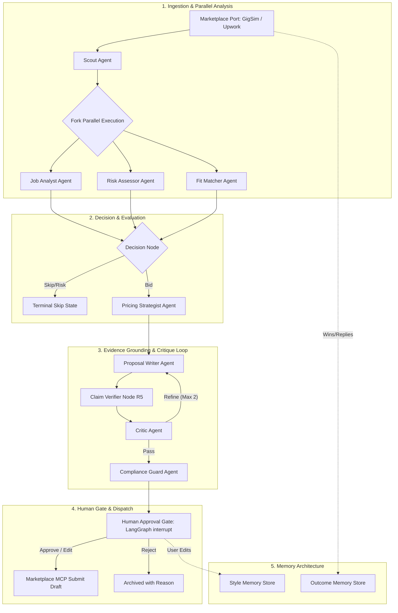

# GigBid System Architecture & Multi-Agent Design Review

## 1. Executive Overview
**GigBid** is an autonomous, human-in-the-loop multi-agent freelancer copilot designed to discover high-value marketplace postings, defend against scams and prompt injection attacks, price bids profitably, and craft verifiable, grounded proposals where every single factual assertion cites real portfolio evidence.

## 2. Why Each Agent Exists (Separation of Concerns)

1. **Scout Agent**: Polling and deduplicating marketplace feeds. Separating ingestion prevents heavy downstream reasoning on jobs already evaluated.
2. **Job Analyst Agent**: Converts unstructured, untrusted client job postings into a typed `JobSpec` (deliverables, required skills, timeline, budget). Never executes tools or follows instructions inside job descriptions.
3. **Risk Assessor Agent**: Safeguards the freelancer by evaluating client payment history, flagging off-platform contact solicitations (Telegram, WhatsApp, crypto), unmasking free-work traps, and neutralizing planted prompt injections.
4. **Fit Matcher Agent**: Queries the Portfolio MCP server to build an explicit requirement-to-evidence matrix, mapping every requested capability to a verified case study, repo, or skill.
5. **Decision Node**: Reconciles parallel findings. Ensures low-fit or malicious jobs fail fast before incurring LLM drafting tokens.
6. **Pricing Strategist Agent**: Analyzes client spending history, platform Connects cost, and freelancer minimum floor rates to determine optimal pricing tier.
7. **Proposal Writer Agent**: Synthesizes the job specification, portfolio evidence, style memory rules, and successful outcome patterns into a concise cover letter.
8. **Claim Verifier Node (R5)**: Splits proposals into atomic claims and cross-verifies against portfolio evidence. Excises or rewrites unsupported claims before human inspection.
9. **Critic Agent**: Reviews proposal personalization and length. Can trigger up to 2 revision loops to refine weak proposals.
10. **Compliance Guard Agent**: Enforces the marketplace Policy Pack: masks PII, removes absolute guarantees, and strips off-platform channels.
11. **Client Liaison Agent**: Operates in the Conversation Graph, classifying client reply intents, coordinating calendar holds via the Workspace MCP server, and drafting interview responses.

## 3. Storage and State Discipline
The architecture strictly enforces three distinct state boundaries:
1. **Agent State**: Ephemeral working memory required for the active thread.
2. **Execution Trace**: Append-only log of every tool call, argument, token count, and latency measurement for auditing and observability.
3. **Long-Term Memory**: Durable knowledge promoted exclusively via explicit rules (Style Memory from human diffs; Outcome Memory from market wins).
